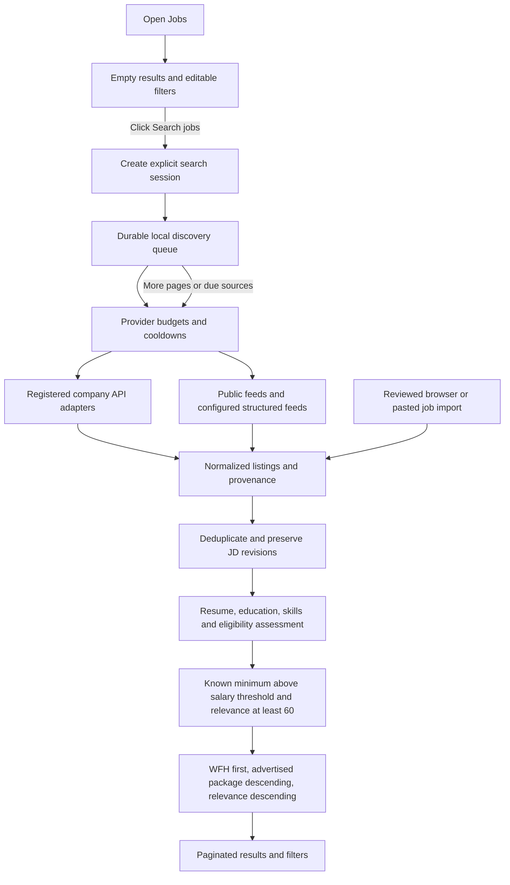

**Latest operating rule and controls:** Personal discovery is paused at the user’s request while source tools are completed. Undisclosed pay is included by default; relevance and salary filters are flexible. See [TOOL_VALIDATION_STATUS.md](TOOL_VALIDATION_STATUS.md). Earlier strict-pay/60-minimum descriptions below are historical.

# CareerOS connection and explicit-search architecture

2 November 2026. This release supersedes the earlier discovery follow-up for connection setup, catalogue state and search behavior.

## Current workspace state

- All **603 existing job listings were cleared** after a scoped local backup. They had no application references, so all 603 postings and their listing dependencies were removed. General clearing preserves postings required by application history and hides them from results.
- **0 visible jobs**, **0 queued/running tasks**, **1 active master resume** at final verification.
- **13 enabled free source connections**, covering Greenhouse, Lever, Ashby, SmartRecruiters, Workable, Remotive, Jobicy and Himalayas. The prior Adzuna flag remains preserved; that source is excluded by the free coordinator.
- Discovery is persistently **paused** and recurring automation is **disabled**. No personal job search was started. Verification fetched one Freshworks posting only to test connectivity, without storing it in the personal database.
- Saved minimum annual salary is ₹550,000. The displayed search threshold is strictly above this value.
- No frontend, backend, worker or Docker service was started, stopped or restarted. No dependency installation or migration was required.

Backup before clearing: `.implementation-backups/connection-architecture/20261102T111101868189.json` (7,356,916 bytes). A second setup snapshot precedes the Freshworks connection: `20261102T112156778938.json`. These are scoped JSON data exports, not database schema dumps.

## Implemented flow

The browser makes no job-result request and initiates no discovery when Jobs opens. Clicking Search jobs queues a manual search session. The worker continues its bounded pages/source batches while recurring automation remains off. Search sessions do not automatically prepare PDFs or submit applications. Resume preparation, skill confirmation and application tracking retain their separate existing controls.

Search progress is polled only after that click. If the worker is not running, the page explains that the search is queued and points to Automation. Leaving and reopening Jobs starts with empty UI again; it does not initiate another scan. Provider polling floors/backoff still apply, so a requested search can defer sources until their next allowed check.

Clearing pauses discovery, cancels pending discovery/preparation, removes current listing data, and resets traversal cursors while preserving provider deadlines. In-flight new-code scans check the search generation before ingestion, preventing a cleared or replaced scan from repopulating the catalogue.

## Adapter and connection layer

- `backend/jobs/adapters.py` is the executable registry and dispatcher. APIs and feeds share the scheduler, snapshot contract, checkpoints, ingestion, assessment and health reporting. Registering an implementation makes it available to source setup; a directory inventory entry alone does not.
- `backend/jobs/connections.py` supplies connection state and required next actions for all **45 inventory entries**. It exposes available, connected, feed-required, reviewed-import and excluded states, without marking unsupported platforms as collectors.
- `POST /jobs/connections/free` idempotently connects verified free defaults. Existing disabled-source choices, preferences, provider cooldowns and automation settings are preserved. Connecting does not discover jobs.
- `backend/jobs/structured_feeds.py` adds RSS, Atom, common job XML, canonical job JSON and Schema.org JobPosting/JSON-LD parsing. `POST /jobs/sources/feed` saves an explicit public feed configuration; it reuses normal source refresh and never follows application links.
- `backend/jobs/feed_transport.py` restricts these explicit feeds to public HTTPS addresses, validates all resolved addresses, pins the TLS connection to a validated IP, rejects credential URLs and redirects, and bounds response size/time. XML entities/doctypes are rejected. Feed format, full-description setting and configuration persist through scan updates.
- Structured-feed descriptions default to excerpts unless explicitly configured as complete. Changed feeds safely restart offset traversal. Rolling feeds never infer closure from missing entries; supplied expiry is retained.
- A new native adapter or authorized transport can be registered without building another scheduler, queue, matching system or MCP server. Existing Jobicy/Himalayas HTTP routes already provide the data used by discovery; a second MCP wrapper is not required for them.

The direct company directory has 11 mappings. Meesho is retained as a known board but excluded from automatic free setup because its earlier API probe timed out. Freshworks was added after its public SmartRecruiters board returned one complete description in a bounded two-request check. Live source health is separate from connection state and is not a promise of suitable openings.

### Connected sources

| Family | Connections |
| --- | --- |
| Greenhouse | Stripe, Canonical, Point72, Razorpay Software Private Limited, Graviton Research Capital LLP |
| Lever | ION Group |
| Ashby | Ashby, AiStudio |
| SmartRecruiters | Freshworks |
| Workable | Digitals AI Inc |
| Public feeds | Remotive, Jobicy, Himalayas |

## Search, eligibility and salary policy

The website always requests relevance **at least 60** and a known advertised salary minimum **strictly greater than ₹5.5 lakh/year**. A higher saved salary preference also applies. A ₹5–8 LPA range or an exact ₹5.5 LPA figure is excluded. Upper-bound-only, undisclosed and non-INR salaries without a verified conversion are excluded from this strict view. No exchange rate or salary is invented. This can produce few or no results because many employers do not publish compensation.

`backend/jobs/salary.py` normalizes explicit annual/monthly INR source fields and clearly stated INR/LPA compensation text. Monthly pay is annualized. Ashby requests its documented public compensation fields; Schema.org baseSalary fields are retained. Salary records remain employer/source statements, not a guaranteed offer or take-home pay.

Relevance uses target-role alignment, skills evidenced in the active master or confirmed skills, degree/course evidence, freshness and eligibility. Optional Degree and Course fields supplement the resume. The score is deterministic and explainable: role alignment up to 40, skill coverage up to 40, absence of explicit eligibility blockers 10, academic alignment 5, and freshness 5. Unclear experience remains capped at 60; explicit seniority, experience, location, country, graduation and other blockers retain their existing filtering. This is a screening rule, not a hiring probability.

Default order: WFH, hybrid, on-site, then unknown arrangement. Within each group, advertised annual package upper bound sorts descending, followed by relevance. Hybrid jobs are not treated as fully remote. Other sort choices are highest/lowest salary, relevance, newest, WFH first and on-site first.

Filters cover work arrangement, employment type, source, known publication age, minimum salary, minimum relevance, eligibility review and saved/dismissed state. The text field filters role/company/location in retained results. Target roles and fresher eligibility remain editable in Preferences. Pagination and source attribution remain available. Lower-level feed queries retain diagnostic options for existing internal/API consumers; the website passes the stricter requested thresholds.

## Validation

- Full focused backend suite: **189 passed, 3 skipped**. The final higher-saved-salary check passed in the 28-test search suite afterward. Skips are the existing opt-in Docker compiler cases.
- Production build passed for all 21 routes in `.next-search-architecture-check`, after retrying a sandbox EPERM outside the sandbox. The normal running `.next` output was not rebuilt; generated tsconfig changes were restored.
- Browser QA used static build files and an intercepted in-memory SQLite API. It verified zero results/discovery requests on page load, explicit Search jobs, 60+ relevance and salary policy, WFH/salary sorting, 55-record pagination, details/save, connection controls, source setup and 390/700px layouts. No browser errors or horizontal overflow.
- Tests also cover idempotent connections, preserved disabled choices, feed configuration persistence, public-address/redirect boundaries, XML entity rejection, five feed formats, salary false positives, manual continuations while scheduling is off, clearing during a network request, and preserved application/master history.
- No generated test records entered the personal database. Screenshots: `scratch/search-architecture-ui/`.

## Remaining external integrations

The core connection/search architecture is implemented. That does **not** establish native collectors for every named website. LinkedIn, Naukri, Unstop, Internshala, Wellfound and the other unverified platforms retain an original-site/reviewed-import route. Enterprise ATS entries can use an employer's available public feed through the new feed adapter, but no such feed is assumed for every Workday, Oracle, Taleo, SuccessFactors or iCIMS employer.

Sources → Source connections now shows the exact prerequisite when an unattended route is unavailable: an employer/public feed URL or supported export/partner access. Browser account login alone is not represented as a catalogue API. No job-board passwords, cookies, paid proxies, trial APIs or account automation were introduced. Individual native adapters and a broad independent market-recall benchmark remain separate unfinished work; the interface does not label them connected.

References for supported formats and the new employer mapping: [Schema.org JobPosting](https://schema.org/JobPosting), [RSS specification](https://www.rssboard.org/rss-specification), [Ashby public compensation fields](https://developers.ashbyhq.com/docs/public-job-posting-api), [Freshworks careers](https://www.freshworks.com/company/careers/), [Freshworks public board](https://careers.smartrecruiters.com/Freshworks).

## Load the release when ready

Reload/restart the backend and worker yourself in the existing terminals so both use this code. No Docker restart or migration is needed. A frontend development server can hot reload; production mode needs your normal build/start workflow. Discovery remains paused until Search jobs is clicked, and recurring automation remains off. No actual search needs to be run to inspect Sources, Preferences or the empty Jobs page.
